# Ink Landscape

Your GitHub contribution calendar, drawn as an endlessly drifting ink landscape.

Mountains grow with monthly activity. Dates and totals travel with their peaks. Birds flap across the sky at different depths, while fish leave ripples that drift with the river. Clouds, reflected water, and brushwork trees complete the scene. The artwork is an animated SVG that works inside a normal GitHub README.

## White paper

<picture>
  <source media="(prefers-reduced-motion: reduce)" srcset="assets/landscape-white-still.svg">
  
</picture>

## Dark jade

The original green palette, with the current clean layout and animation.

<picture>
  <source media="(prefers-reduced-motion: reduce)" srcset="assets/landscape-green-still.svg">
  
</picture>

<details>
<summary>Charcoal edition</summary>

<picture>
  <source media="(prefers-reduced-motion: reduce)" srcset="assets/landscape-black-still.svg">
  
</picture>

</details>

All three editions use the same contribution data and mountain shapes. The examples above show [bulletchicken’s](https://github.com/bulletchicken) real profile activity. Each edition includes an animated image and a reduced-motion still.

## Use it in your README

1. Fork this repository. Keep its name as `ink-landscape`, or adjust the image URLs below to your chosen name.
2. Open **Actions** in your fork and enable the workflows. Scheduled workflows are [disabled by default in public forks](https://docs.github.com/en/actions/how-tos/manage-workflow-runs/disable-and-enable-workflows).
3. Run **Refresh landscape** once. A blank username uses the repository owner. For an organization-owned fork or a different account, set the repository variable `LANDSCAPE_USER` to the GitHub username you want to draw.
4. Paste this into your profile README, replacing `YOUR_USERNAME` with the owner of your fork:

```html
<picture>
  <source media="(prefers-reduced-motion: reduce)"
          srcset="https://raw.githubusercontent.com/YOUR_USERNAME/ink-landscape/main/assets/landscape-white-still.svg">
  
</picture>
```

Change `white` to `green` or `black` in both filenames to select another edition. The workflow refreshes all six images daily at **06:23 UTC**. A username entered for a manual run applies to that run only; use `LANDSCAPE_USER` for a lasting override.

The included workflow uses GitHub’s built-in `GITHUB_TOKEN`, with write access to publish generated files in this repository. No personal token setup is needed for the default profile calendar.

## What the mountains count

This is a **contribution** landscape, not a count of commits alone. It uses GitHub’s default profile contribution calendar—the same calendar used by the [3D contribution graph](https://github.com/yoshi389111/github-profile-3d-contrib). GitHub can include commits, issues, pull requests, reviews, and other qualifying activity.

Private contribution totals follow what GitHub makes available through the credential and the account’s [profile visibility settings](https://docs.github.com/en/account-and-profile/how-tos/contribution-settings/manage-visibility-settings-for-private-contributions-and-achievements). For the default workflow, enable private contributions on the profile to include those anonymous counts. Only daily aggregate counts are requested and saved. The fetch does not query repository names, commit messages, or private activity details.

- Each main mountain represents one calendar month. The first and last months may be partial.
- Height grows with the **square of the monthly total**, relative to the busiest month. Above the small minimum height, totals of 150, 100, and 50 produce heights in the ratio **9:4:1**.
- Month/year labels, totals, and daily calendars scroll with their mountains. Exact dates remain in `data/activity.json` and in SVG tooltips when the image is opened directly.
- The large counter beneath the scene sums contributions in the **displayed calendar window**. It is not a lifetime total.
- Background peaks, trees, clouds, birds, and river life are decorative. A fish jumps every three seconds, visiting twenty locations per minute. Its expanding ripples drift downstream with the water after takeoff and landing.
- Smaller, fainter birds pass behind the main mountains; closer birds cross in front. Their wings flap as they travel, giving the sky another layer of depth.
- The scene loops every 180 seconds. Reduced-motion preferences disable animation; the README embed also selects a still image.

GitHub’s returned calendar defines the date window. The generator does not impose a separate 365-day cutoff or exclude the current day.

## Run locally

The current renderer needs **Python 3.12** and its standard library. Authenticate the GitHub CLI with `gh auth login`, or provide `GITHUB_TOKEN` / `GH_TOKEN` in your environment to fetch activity.

```sh
python3 scripts/fetch_activity.py --user YOUR_GITHUB_USERNAME
python3 scripts/generate.py --theme all
```

Rendering itself is offline. To redraw the saved data in one palette:

```sh
python3 scripts/generate.py --theme green
```

Custom input and output paths are supported:

```sh
python3 scripts/generate.py --theme white --input data/activity.json --output-dir output
python3 -m unittest discover -s tests -v
```

| File | Purpose |
| --- | --- |
| `assets/landscape-{white,green,black}.svg` | Animated README images |
| `assets/landscape-{white,green,black}-still.svg` | Reduced-motion images |
| `data/activity.json` | Daily profile contribution counts |
| `scripts/fetch_activity.py` | Fetch and validate GitHub’s calendar |
| `scripts/generate.py` | Compose the landscape and export themes |
| `scripts/palette.py` | White, dark jade, and charcoal colors |
| `scripts/terrain.py`, `vegetation.py`, `ambient.py`, `birds.py` | Mountains, plants, weather, river currents, and birds |

## Earlier versions and history

All **seven landscape commits** from the profile repository are preserved in this repository’s history, with their original authors, dates, and messages. Extraction moved the project to the root, so commit hashes changed; [the history map](docs/HISTORY.md) links both versions.

The [experiments archive](experiments/README.md) also preserves the earlier weekly mockup, original green monthly version, and the edition using Lingdong’s original engine with people, boats, and architecture. Those experiments use clearly labeled fictional sample activity. Their previously unversioned files were imported as a new archive commit.

## Credits and license

The current renderer adapts the mountain-contour and tapered-brush techniques of **[Lingdong Huang’s {Shan, Shui}*](https://github.com/LingDong-/shan-shui-inf)**. The original-engine experiment vendors the upstream source at a documented revision; the current Python renderer is an adaptation, not the full original engine.

MIT licensed. See [LICENSE](LICENSE), [third-party notices](THIRD_PARTY_NOTICES.md), and the attribution preserved with each experiment.
