# Original green landscape experiment

This dark jade edition develops the weekly design into closely spaced monthly mountains, with attached labels, a connected shore, parallax, varied trees, clouds, water, and fish. It uses **fictional 1,417 commits across 269 active days**, from October 26, 2025 through October 24, 2026. No GitHub activity is fetched.

<picture>
  <source media="(prefers-reduced-motion: reduce)" srcset="assets/nocturne-still.svg">
  
</picture>

## Regenerate

From this folder, using Python 3 and its standard library:

```sh
python3 scripts/generate.py
```

From the repository root, run `python3 experiments/original-green/scripts/generate.py`.

The generator reads `data/activity.json` and creates [the animated SVG](assets/nocturne.svg) and [the still SVG](assets/nocturne-still.svg). Main mountain height follows squared monthly totals; the first and last Octobers are partial months. Dates and totals travel with their mountains. Decorative scenery does not encode extra activity.

The scene repeats every 180 seconds. This historical snapshot retains its original summary, date ranges, footer, and four fish positions, with a jump about every 7.5 seconds. The [current renderer](../../) contains the later clean layout, real contribution data, and more frequent fish.

The mountain and tapered-brush techniques are adapted from [Lingdong Huang's {Shan, Shui}*](https://github.com/LingDong-/shan-shui-inf). This is a simplified renderer; the [original-engine experiment](../original-engine/) executes the upstream drawing functions directly. See [attribution and the MIT notice](THIRD_PARTY_NOTICES.md).
