# Weekly landscape experiment

The first landscape design uses **fictional 1,417 commits across 269 active days** over 52 weeks, from October 26, 2025 through October 24, 2026. Each mountain represents a week, each pine represents an active day, and the stationary calendar shows daily counts. The animated scene repeats the fixed sample; it does not fetch GitHub activity.

<picture>
  <source media="(prefers-reduced-motion: reduce)" srcset="assets/commit-landscape.svg">
  
</picture>

## Regenerate

From this folder, using Python 3 and its standard library:

```sh
python3 scripts/generate_landscape.py
python3 scripts/animate_landscape_svg.py
```

From the repository root, use `python3 experiments/weekly/scripts/generate_landscape.py`, followed by `python3 experiments/weekly/scripts/animate_landscape_svg.py`.

## Variants

| Layout | Green | Light paper |
| --- | --- | --- |
| Animated desktop | [SVG](assets/commit-landscape-loop.svg) | [SVG](assets/commit-landscape-loop-light.svg) |
| Still desktop | [SVG](assets/commit-landscape.svg) | [SVG](assets/commit-landscape-light.svg) |
| Animated mobile | [SVG](assets/commit-landscape-loop-mobile.svg) | [SVG](assets/commit-landscape-loop-mobile-light.svg) |
| Still mobile | [SVG](assets/commit-landscape-mobile.svg) | [SVG](assets/commit-landscape-mobile-light.svg) |

This historical version retains its original title, summary, and fixed calendar. The later monthly design is available in [original-green](../original-green/).

Mountain contours and tapered brushwork adapt techniques from [Lingdong Huang's {Shan, Shui}*](https://github.com/LingDong-/shan-shui-inf). See [attribution and the MIT notice](THIRD_PARTY_NOTICES.md).
